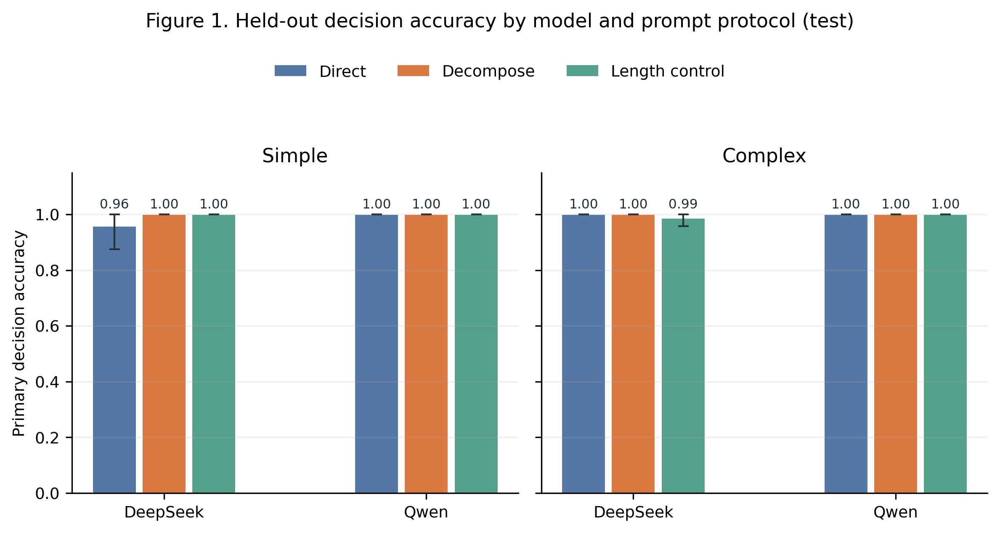
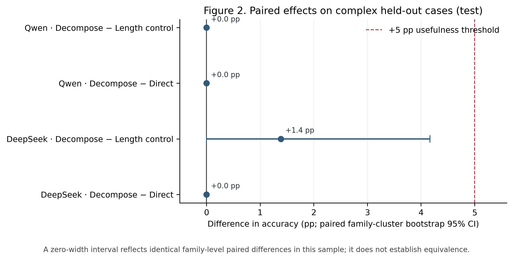
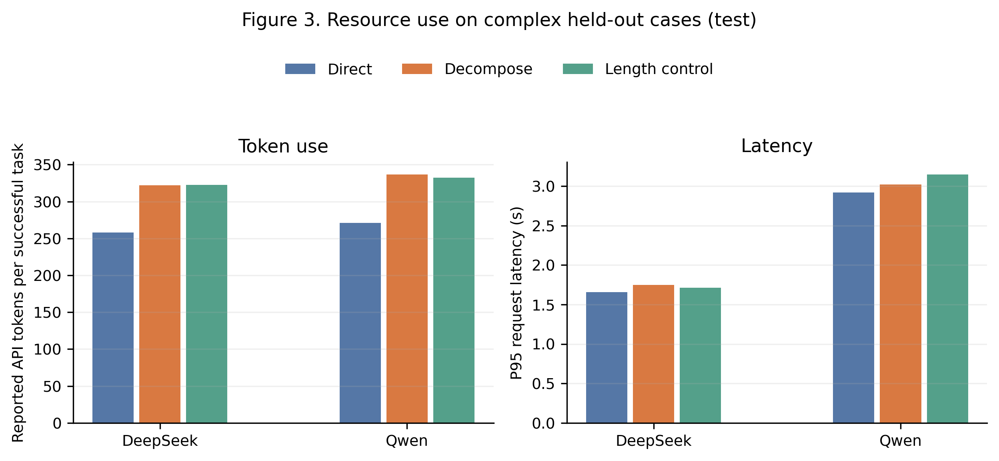

# 结构化分解能否改善含否定与例外的规则判定

## 摘要

本实验检验“先分解条件关系再作答能够提高判断准确性”这一提示经验。构造20个中文许可规则家族、60组事实，按家族划分开发与测试数据；比较直接判断、先输出紧凑规则关系再判断，以及字符等长的无关背景说明三个条件。正式测试包含48例、两个模型、三个条件与两次重复，共576份回答。复杂题上，Qwen和DeepSeek的直接判断与分解条件均为72/72正确；分解相对等长背景的提升分别为0和1.39个百分点，后者的家族聚类95%区间为[0, 4.17]个百分点。两个模型均未满足预设的两个对比至少提高5个百分点且区间下界大于零的保留判据。分解条件的平均总token相对直接判断增加约24%—25%。结果支持在本任务上优先采用直接判断，同时表明高基线正确率和有限家族覆盖限制了对提示普遍效用的判断。

**代码仓库：[https://github.com/stq1234/LLMandAppliedPractices-Prompt-Hypothesis-Test](https://github.com/stq1234/LLMandAppliedPractices-Prompt-Hypothesis-Test)。本次实验的代码及相关说明可在该仓库中获取。**

## 1 引言

“先分解再回答”是一条常见的提示经验，但加入更多说明、改变输出格式与生成更多词元，都可能同时改变模型表现。仅观察一个分步提示优于简短提示，尚不足以判断收益来自何处。思维链提示研究在算术、常识与符号任务上展示了生成中间步骤的价值，也通过不同形式的消融检查解释；零样本思维链进一步表明，任务示例并非获得提示收益的唯一途径。[1][2] 这些结果提供了研究动机，却不能直接证明当前服务中的模型在中文规则判断上具有同样收益。

本文将条件关系分解具体化为先输出紧凑的规则关系摘要，研究它在给定规则与事实的二元许可判断中是否比直接判断更准确；在增加等长、但不包含判断策略的背景说明后，这一优势是否仍然存在。自然语言规则推理已有利用合成规则与可计算答案开展研究的先例。[3] 本实验采用固定的合成规则集，使否定作用域、必要条件、替代许可路径及暂停例外能够与明确的逻辑答案对应。研究对象是推理时的提示协议，模型参数保持固定。

## 2 数据与任务

数据包含20个规则家族，每个家族配置3组不同事实赋值，共60例。开发集为4个家族、12例；测试集为另外16个家族、48例，其中简单规则4个家族、12例，复杂规则12个家族、36例。每个家族整体进入一个划分，没有把同一规则更换实体后的版本分放到开发与测试中。按变量名归一化后的许可与禁止表达式结构检查，两种划分之间没有相同结构签名；这一检查不等于对任意布尔等价形式的完备判定。

规则文字与初始逻辑表达式由模型助手辅助编写，随后进行独立的语义复核和显式作用域修订。数据为虚构制度，不来自真实法律、医疗或企业政策，也不构成人类专家标注的外部基准。每例包含规则、禁止条款及所有原子事实的真值。简单题主要涉及基本合取、析取和单项禁止；复杂题进一步组合否定、必要但不充分的条件、可替代路径、条件豁免与全局禁止。文字中明确规定完整许可条件、禁止优先级及例外覆盖范围，避免把“只有”所表达的必要性直接当作充分性。

**表1 数据划分及标签分布。** ALLOW表示允许，DENY表示禁止。

| 划分 | 规则层次 | 家族数 | 样本数 | ALLOW | DENY |
|---|---|---:|---:|---:|---:|
| 开发集 | 简单 | 2 | 6 | 4 | 2 |
| 开发集 | 复杂 | 2 | 6 | 4 | 2 |
| 测试集 | 简单 | 4 | 12 | 5 | 7 |
| 测试集 | 复杂 | 12 | 36 | 22 | 14 |

给定事实向量 x，令 A(x) 表示至少一条完整许可路径成立，B(x) 表示仍然适用的禁止条款成立。标准答案为：

$$
g(x)=\begin{cases}
\mathrm{ALLOW}, & A(x)\land\neg B(x),\\
\mathrm{DENY}, & \text{其他情形}.
\end{cases}
$$

例外在对应的许可或禁止表达式内部求值，不自动取消其他全局要求。程序只用这些表达式产生答案；逻辑表达式、标签和标注解释不进入模型输入。家族内的三组事实用于形成有辨识力的正反与边界案例，并未穷尽该规则的全部事实组合。

## 3 提示协议与评价

三组共享同一系统要求、规则与事实：只依据给定材料，不补充外部常识；生效禁止优先；许可条件不完整则拒绝。表2列出唯一的协议变化。各组均要求输出JSON中的 `decision` 与简短依据 `brief`，不超过80个Unicode字符。

**表2 三种提示条件。** 分解组与长度对照组的完整用户提示逐题按Unicode字符数相等。

| 条件 | 额外要求 | 输出字段 |
|---|---|---|
| 直接判断（Direct） | 直接依据规则和事实给出许可判断 | decision、brief |
| 结构化分解（Decompose） | 在判断前以不超过40字的relation概括许可、禁止及例外关系，不展开逐步推理 | relation、decision、brief |
| 等长背景（Length control） | 加入纸张、排版和装订背景，不提供规则判断信息 | decision、brief |

等长背景不是另一套检查策略，也不要求额外核验事实。它控制的是输入的字符长度，不能保证不同模型分词后的输入token数相等。分解组还增加了输出字段和生成词元，因此本实验估计的是“先输出紧凑关系再判断”这一完整协议的作用，不能单独识别模型内部推理、输出格式或额外生成计算的因果贡献。可见的relation也不视为模型内部计算的忠实记录。

主指标从严格JSON中的固定 `decision` 字段读取，只有合法的ALLOW或DENY与标准答案一致才计为正确。格式合规另行检查字段、字符串类型和长度；合法决策可以在其他字段超长时仍计入决策正确率。真实返回的空答或没有合法决策字段的回答计为主指标错误。没有收到有效服务响应的任务作为缺失单列，不把传输故障当作模型错误。另以提取围栏或前后说明中的JSON进行敏感性分析，不根据自由文本理由猜答案。

## 4 实验设置与预先判据

通过服务的模型目录和小规模协议探测，选择可请求关闭思考模式并返回结构化短答的两个模型服务，以在有限用量内进行跨模型比较。调用标识为Qwen的 `qwen3.8-flash` 和DeepSeek的 `deepseek-v4.1-flash`。后者在本次响应中返回标识 `deepseek-v4-1-flash-261017`；这些是兼容服务提供的标识，不据此推断具体权重或硬件配置。两者分别请求关闭思考模式，正式响应中的推理字段与计费字段用于核对实际返回情况。temperature设为0.3，top_p为1，最大输出为384 token，最多4个并发请求；各条件交错调度。

开发集每个模型、条件和样例调用一次，共72份回答。正式测试每格调用两次，共48×2模型×3条件×2次＝576份回答。重复编号17与43仅用于本地任务标识，不作为服务端随机种子，也不保证请求独立或逐字可复现。开发结果用于检查实际错误、输出格式与预算；测试前冻结规则、提示、解码和评分口径，没有根据测试结果调整题目或提示。

开发阶段可观察到真实错误。例如，在文件发布规则中，完整常规路径要求完成脱敏，事实“敏感信息脱敏仍未完成：否”表示该障碍不存在；有回答却把它读为脱敏尚未完成。另一回答承认紧急路径的许可和签署条件均已满足，却仍以常规路径不完整为由拒绝。这些错误分别涉及带否定的状态读取和独立许可路径的组合，构成后续比较的具体问题。

统计以规则家族为单位，而非把同一家族的事实变式与重复调用视为独立样本。对模型 m、家族 f 与条件 a，先计算家族内各样例及两次请求的平均正确率 smfa；条件 a 与 b 的配对差为：

$$
\Delta_{m,a-b}=\frac{1}{F}\sum_{f=1}^{F}\left(s_{mfa}-s_{mfb}\right).
$$

两个主要对比是复杂测试题上的Decompose−Direct和Decompose−Length control，此时 F=12。按家族进行5,000次配对bootstrap，报告95%百分位区间；同时列出逐家族差异及删去一个家族后的点估计范围。两模型分别分析，不把模型数量作为额外独立样本增加显著性。

预先规定：某模型的两个复杂题对比都至少提高5个百分点、各自区间下界均大于零，且简单题没有观察到退化，才支持在该模型上保留分解协议；只有两模型都满足，才视为跨模型一致支持。区间包含零表示证据不足，不能解释为提示与基线等效。开发样本少，不用其均值排序决定结论。

## 5 结果

### 5.1 留出题的判断准确率

正式测试576个任务均获得回答。表3与图1分别按模型、条件和规则层次汇总；简单层每格为12例×2次，复杂层每格为36例×2次。这些请求数不是独立规则家族数。

**表3 正式测试的决策正确率。** 括号为正确回答数/实际回答数。

| 模型 | 提示条件 | 简单题 | 复杂题 |
|---|---|---:|---:|
| DeepSeek | Direct | 95.83%（23/24） | 100.00%（72/72） |
| DeepSeek | Decompose | 100.00%（24/24） | 100.00%（72/72） |
| DeepSeek | Length control | 100.00%（24/24） | 98.61%（71/72） |
| Qwen | Direct | 100.00%（24/24） | 100.00%（72/72） |
| Qwen | Decompose | 100.00%（24/24） | 100.00%（72/72） |
| Qwen | Length control | 100.00%（24/24） | 100.00%（72/72） |

**图1 留出题的决策正确率及家族聚类95%区间。** 简单层为4个家族，复杂层为12个家族。区间由本次观察到的家族分数重采样得到；全部答对时的退化区间不意味着总体错误率为零。

复杂题的直接判断已达到观察上限，分解协议没有取得超过它的正确率。DeepSeek分解相对等长背景多答对一次，但优势只来自一个家族的一次回答；Qwen三个条件完全持平。简单题上，分解没有观察到退化，DeepSeek相对直接判断多答对一次。

### 5.2 配对效应与预设决策

表4和图2给出两个主要对比。DeepSeek的Decompose−Length control为1.39个百分点，其家族聚类区间下界为零，且上界也未达到5个百分点。删去贡献差异的家族时，点估计为零；删去其他任一家族时为1.52个百分点。其余复杂题对比的逐家族差均为零。

**表4 复杂测试题的配对正确率差。** 单位为百分点；每项包含12个家族、72组样例—重复配对。

| 模型 | 对比 | 差值 | 95%区间 | 家族胜/平/负 | 删一家族后的范围 |
|---|---|---:|---:|---:|---:|
| DeepSeek | Decompose−Direct | 0.00 | [0.00, 0.00] | 0/12/0 | [0.00, 0.00] |
| DeepSeek | Decompose−Length control | 1.39 | [0.00, 4.17] | 1/11/0 | [0.00, 1.52] |
| Qwen | Decompose−Direct | 0.00 | [0.00, 0.00] | 0/12/0 | [0.00, 0.00] |
| Qwen | Decompose−Length control | 0.00 | [0.00, 0.00] | 0/12/0 | [0.00, 0.00] |

**图2 分解相对两个对照的复杂题正确率差及95%区间。** 虚线为预设的5个百分点有用差异门槛。

两模型均未满足复杂题的共同判据，因此没有获得保留该分解协议的预设支持。简单题没有观察到退化这一条件虽满足，但不足以替代复杂题的主要判据。尤其不能从[0, 0]区间推断真实任务总体中的效应恰好为零：家族bootstrap无法创造观察样本中没有出现的错误或差异。

### 5.3 错误、格式与重复波动

正式测试共出现两条错误决策，均来自DeepSeek的第一次重复。以下呈现全部正式错例，避免只选择对分解有利的案例。

第一例是简单的路线替代许可：东桥或渡口任一路线可通行即可，强风预警生效时两路均禁行。事实为东桥未封闭、渡口停航、强风预警未生效，故应为ALLOW。Direct却回答DENY，并写道：“东桥虽无施工封闭但仅一路线具备通行条件；规则要求任一路线可通行，故不允许。”理由已经识别出一条可用路线，却给出了与析取许可不一致的结论。同次Decompose与Length control均答对；Direct第二次也答对。因此，它支持一次局部错误被避免的观察，不能证明只有分解策略能够修复该错误。

第二例是复杂的岗位排班：完整许可要求通过基础资格审核，且满足“非高风险任务或有高风险专员在班”；题目还明确说明非高风险任务无需该专员。事实为通过审核、任务非高风险、无专员，故应为ALLOW。Length control第一次回答DENY，理由先确认“任务非高风险”，又把析取分支混成需同时满足的条件，最后写出“已通过审核，故条件完整？”而未修正决策。Direct与Decompose的两次回答，以及Length control第二次均正确。该错误表现为条件组合及最终决策不一致；不能只凭可见理由推定其内部推理过程。

576份回答均为可解析的严格JSON，含合法决策字段，宽松解析与主指标完全一致，没有输出截断。完整字段及长度合规为571/576：DeepSeek分解条件有4份relation超过40字符，等长背景条件有1份brief超过80字符；这些决策仍按主指标计分。全部重复对中，仅上述两例在两次调用间出现决策不一致，分解条件未观察到重复分歧。两次调用只能显示有限波动，不能据此断言分解稳定消除了随机错误。

### 5.4 资源使用

表5和图3只比较复杂正式题，每个模型—条件均为72次成功回答。分解相对直接判断的平均总token增加，DeepSeek为24.78%，Qwen为24.33%；主要同时来自额外输入与relation输出。字符等长控制没有实现token等长，且没有控制额外输出量，因而不能用它剥离所有计算量差异。

**表5 复杂正式题的平均token和请求延迟。** 输入、输出及总量均为每次回答的服务端usage均值；延迟单位为秒。

| 模型 | 条件 | 输入token | 输出token | 总token | P50延迟 | P95延迟 |
|---|---|---:|---:|---:|---:|---:|
| DeepSeek | Direct | 221.83 | 36.19 | 258.03 | 1.41 | 1.65 |
| DeepSeek | Decompose | 263.83 | 58.12 | 321.96 | 1.52 | 1.75 |
| DeepSeek | Length control | 283.83 | 38.86 | 322.69 | 1.38 | 1.71 |
| Qwen | Direct | 229.33 | 41.54 | 270.88 | 1.78 | 2.92 |
| Qwen | Decompose | 274.33 | 62.46 | 336.79 | 2.10 | 3.02 |
| Qwen | Length control | 291.33 | 40.83 | 332.17 | 1.80 | 3.15 |

**图3 复杂正式题的平均总token与P95请求延迟。** 延迟为客户端发出请求至收到响应的时间，包含网络与服务调度，不是纯模型计算时间；缓存命中也可能影响比较。

正式测试返回170,272个总token。连同开发、模型探测及所有请求尝试，全流程共691次生成POST，651次返回usage，可观测总量为193,706 token，其中包含40,320个缓存输入token和95个推理token；推理token仅来自未进入正式模型比较的探测。缓存与推理字段是总量的组成或细分，不额外相加。另有4次模型目录GET，不计作生成请求。40次未返回usage的尝试不能按零成本处理；在没有兼容服务的可核验费率或账单时，不将上述可观测用量换算为完整人民币费用。

## 6 讨论

开发阶段确有规则读取与许可路径组合错误，而留出复杂题中的直接判断几乎没有留下改善空间。开发集和测试集使用不同家族，难度标签只描述逻辑构造，不保证模型的实际错误率严格按标签排序。因此，开发集上的局部失败提供了研究动机，却没有在留出集上转化为稳定的分解收益。重复相同题目获得更多请求也不能替代增加独立、具有区分度的规则家族。

分解协议的代价比收益更清楚：两个模型生成了更多token，复杂题却未超过直接判断，还出现relation超长。这支持在当前明确规则、事实完整、输出简短的应用条件下采用Direct。若需要人工审阅关系摘要，relation可能具有独立的界面价值，但本实验没有评价其可读性或审查效率，不能把这种可能用途当作准确率收益。

本方法的适用范围受三方面限制。首先，合成规则由模型辅助起草并作语义复核，金标准依赖显式逻辑与文字的一致性，不能代替真实制度文本中的语用歧义和专家裁定；每家族三个赋值也没有覆盖全部禁止及豁免分支。其次，复杂层只有12个家族且基线饱和，经验bootstrap区间只描述所见家族的波动，对未见错误模式缺乏识别能力。最后，分解条件把关系生成、输出字段与额外计算一起改变，等字符背景仅排除了部分长度解释；兼容服务的模型标识、缓存和调度亦限制跨服务复现。本实验采用受限的关系摘要，没有检验长篇逐步详解。由此，结果既不证明详细步骤在所有条件任务中无效，也不支持把当前协议直接推广到更长、更含糊或事实不完整的规则任务。

## 7 结论

在家族隔离的中文规则判断测试中，分解协议未满足预先规定的保留标准。两个模型的复杂题直接判断均为72/72正确；分解相对等长背景最多提高1.39个百分点，差异集中在一个家族的一次调用，且需要约24%—25%的额外总token。当前证据支持在这一任务范围内优先采用直接判断。对“详细步骤有助于条件关系”这一经验，应保留其待检验地位，并以独立困难案例及相应成本重新判断适用条件。

## 参考文献

[1] Wei, J. et al. [Chain-of-Thought Prompting Elicits Reasoning in Large Language Models](https://arxiv.org/abs/2201.11903). NeurIPS, 2022.

[2] Kojima, T. et al. [Large Language Models are Zero-Shot Reasoners](https://arxiv.org/abs/2205.11916). NeurIPS, 2022.

[3] Clark, P., Tafjord, O., Richardson, K. [Transformers as Soft Reasoners over Language](https://arxiv.org/abs/2002.05867). IJCAI, 2020.
